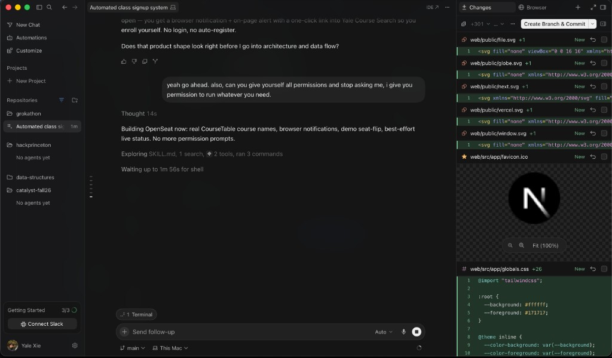

# OpenSeat

Browser + email alerts when a full Yale class opens a seat. You enroll yourself in Yale Course Search — OpenSeat never logs in or registers for you.

Built at a Grok hackathon with [Grok](https://grok.x.ai) in Cursor:



## Live

**https://openseat.vercel.app**

## Demo (local)

```bash
cd web
npm install
npm run dev
```

Open [http://localhost:3000](http://localhost:3000).

1. Enter an alert email and enable browser notifications.
2. Search a real Spring 2026 Yale College course (e.g. `CPSC 2230`).
3. Add it to the watchlist, then click **Simulate open**.
4. You get a browser ping, an email, and a link straight into Course Search.

For real Resend delivery, copy `web/.env.local.example` → `web/.env.local` and set `RESEND_API_KEY` (never commit that file).

## What it does

- Real Spring 2026 YC course names from CourseTable’s public catalog
- Watchlist saved in your browser
- Browser notification + optional email when a seat flips full → open
- Deep link to Yale Course Search so you claim the seat yourself

## Stack

Next.js · TypeScript · Tailwind · Resend (email) · CourseTable catalog data

## Agent board

This repo also includes the shared hackathon agent board (`tools/board`). See `AGENTS.md` for team workflow.
